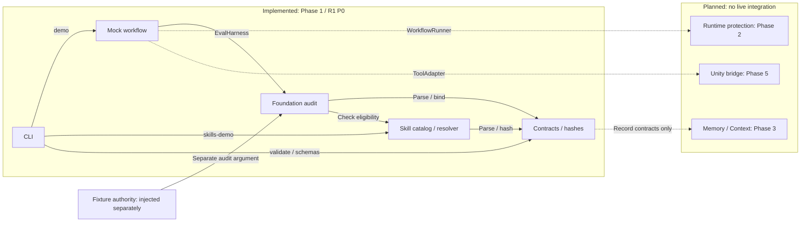

# Architecture and trust limits — Phase 2

This repository implements Phase 1 foundation and Phase 2 local mechanical runtime (T07/T18/T15). It remains a TypeScript modular monolith. Production/Unity task classes are not authorized. Phase 2 uses SQLite durable records, a canonical project OS lock, macOS sandboxed executor/verifier processes and stage-specific gates. See [runtime behavior](runtime.md), [acceptance evidence](phase-2-report.md) and [framework decision](adr/0002-phase2-runtime.md).

| Phase 2 module | Responsibility and boundary |
|---|---|
| PersistentWorkflowRunner | Trusted broker: current plan/policy/skill pins, exact step/subplan ordering, queue, budget lineage, intent-before-effect and reconcile |
| RuntimeStore | SQLite WAL/FULL; immutable artifacts; atomic operation result/checkpoint references; protected outside candidate workspace |
| Evaluation | Planning readiness, pre-dispatch and post-execution are separate; registered verifier results and current protected gate lookup |
| Isolation / lock | Default-deny macOS worker sandbox, stdin dispatch handshake, fcntl OS lock, confirmed group stop or quarantine |
| Fixed executor / verifier | Only bounded fixture write capability; independent read-only content verifier with broker-owned oracle |
| Skill activation | Current pin revalidation and retained descriptor/profile/resources; exact binding in ledger and pre/post gate inputs |

Policy owner, verifier coordinator and Gate Controller are trusted broker roles, not independently deployed services. Candidate executor code is isolated at the OS boundary and cannot read/write policy, oracle, evidence or verdict stores. The local operator, host and broker code remain trusted. Phase 2 does not implement promoted Memory yet.

| Module | Interface and responsibility | Failure behavior |
|---|---|---|
| Contracts | Parse a named versioned contract; canonicalize/hash JSON | Reject unsupported versions, malformed or extra fields and invalid conditional states |
| Foundation audit | Audit a linked record bundle against separate fixture authorities | Return all detected binding/trust/scope defects; never issue runtime dispatch authorization |
| Skills | Load a pinned catalog, discover metadata, resolve compatibility, read selected resources | Unknown prerequisites remain unknown; missing/mismatched/revoked resources are unavailable |
| Mock workflow | Exercise ModelAdapter, read-only ToolAdapter and EvalHarness through WorkflowRunner | Stop on an adapter error or failed conformance; no executable tool names or arbitrary command strings |
| CLI | Parse inputs, invoke the interfaces, render JSON and a nonzero exit status on failure | Invalid syntax/input is an error, not an empty successful run |

Contracts version `0.5.0` makes the v0.4 document design executable and adds the reviewed execution-skill records. This is an artifact/schema version, not a claim that the whole v0.5 system has been implemented. JSON Schema exports describe structure; executable Zod refinements and cross-record checks remain required for full conformance.

## Historical Phase 1 module interfaces

Solid arrows show existing local calls or fixture inputs. Dotted arrows show planned integration points; they do not represent running services or implemented adapters. All five implemented modules belong to the same local application.

This diagram records the Phase 1 boundary before the Phase 2 modules above were added. `MockWorkflowRunner` still returns fixed fixture data; `EvalHarness` still exposes the static full-bundle audit for compatibility. `PersistentWorkflowRunner` is the separate durable implementation with stage checks and protected stores. Memory/Context has contracts but no retrieval implementation. Neither fixture authority nor catalog eligibility authorizes production dispatch.

## Historical Phase 1 actor and store ownership

| Actor | Writable store in the planned runtime | Phase 1 status |
|---|---|---|
| Executor | Candidate workspace, within task scope | Permission model and negative tests only |
| Policy owner | Policy and acceptance oracle/checkset | Separate fixture authority data |
| Verification runner | Trusted evidence | Synthetic records only |
| Gate Controller | Trusted verdicts | Synthetic records only; no production gate issuer |
| Memory promoter | Approved memory | Claim promotion binding checks only |
| Planner / critic | Candidate planning/review artifacts through their future interfaces | Mock model/review fixtures |

The authority configuration is passed separately from candidate records in the historical foundation audit. Phase 2 instead installs it through the operator API and reads it from protected SQLite; candidate submission rejects embedded authority/PASS. Executor and verifier run separately with different filesystem grants. TypeScript types alone are not an OS boundary.

## Storage and future integration

Source-controlled files contain schemas, fixture definitions and example catalog resources. Generated build output is disposable. Demo output is explicitly fixture data, not a production policy or trusted evidence store. No workspace file is modified by a skill resource, and no package script from a researched repository is executed.

Phase 2 implements checkpoint/operation stores, dispatch authorization for `runtime.fixture`, one owner plus OS lock/queue, and explicit recovery. Timeout/cancellation require confirmed process stop, then postcondition reconciliation; no TTL transfers ownership. LangGraph and Promptfoo executable spikes are installed in an isolated package. The main runner retains the small SQLite broker; external graph checkpoints do not replace its operation ledger, gate or ownership rules.

Phase 3 adds Memory/Context retrieval, source lifecycle, compaction rehydration and selective invalidation. Phase 4 adds multi-planning, independent critics and measured policy/skill release decisions. Phase 5 validates one Unity bridge plus recipes, trusted reports and the full T22 scope. Only Phase 6 implements the puzzle game.

## Versioning and paths

Reject unknown schema versions rather than coercing them. Hashes use `sha256:` plus 64 lowercase hex characters. Self-hash fields are omitted only at the documented record root when hashing; nested fields remain covered. A reference ID alone never establishes content identity.

Repository scopes use normalized relative POSIX roots (`src`, `Assets/Scenes`), with segment-aware containment. Wildcards, traversal, empty components and platform-absolute paths are unsupported. File resource access also checks the real filesystem; an allowed-looking string is not a filesystem sandbox.

Project profiles distinguish a desired target from an observed environment. Compatibility or eligibility means a candidate can be considered for that profile. It does not certify the skill, assert Unity is installed, or grant permission to execute it. Certification, scope and policy must still be checked at dispatch in the later runtime.
