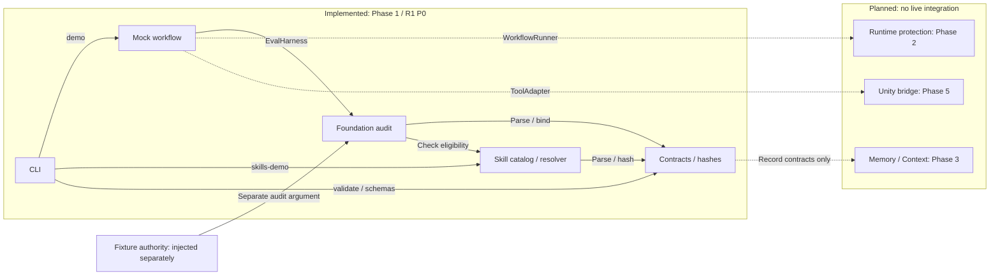

# Architecture and trust limits — local Phase 3

This repository implements Phase 1 foundation, Phase 2 local mechanical runtime and the local Memory/Context/Explorer components of Phase 3. It remains a TypeScript modular monolith. T09/T10 are Done / Pass for their local scope. T19 is Doing / Not evaluated: context mechanics are implemented, but task-quality/loss/latency/token acceptance still needs real provider evidence. T14 implementation/tests exist, while its full handoff gate waits for T19; T14 is Doing / Not evaluated. T11 is Doing / Replan. **The whole Phase 3 has not passed; Phase 4 and gameplay are not open.** See the [Phase 3 report](phase-3-report.md), [Memory/Context guide](memory-context.md) and [remaining work](remaining-work.md).

Production/Unity task classes are not authorized. Runtime uses SQLite durable records, a canonical project OS lock, macOS sandboxed executor/verifier processes and stage-specific gates. See [runtime behavior](runtime.md), [Phase 2 evidence](phase-2-report.md) and [framework decision](adr/0002-phase2-runtime.md).

| Phase 2 module | Responsibility and boundary |
|---|---|
| PersistentWorkflowRunner | Trusted broker: current plan/policy/skill pins, exact step/subplan ordering, queue, budget lineage, intent-before-effect and reconcile |
| RuntimeStore | SQLite WAL/FULL; immutable artifacts; atomic operation result/checkpoint references; protected outside candidate workspace |
| Evaluation | Planning readiness, pre-dispatch and post-execution are separate; registered verifier results and current protected gate lookup |
| Isolation / lock | Default-deny macOS worker sandbox, stdin dispatch handshake, fcntl OS lock, confirmed group stop or quarantine |
| Fixed executor / verifier | Only bounded fixture write capability; independent read-only content verifier with broker-owned oracle |
| Skill activation | Current pin revalidation and retained descriptor/profile/resources; exact binding in ledger and pre/post gate inputs |

Policy owner, verifier coordinator, Gate Controller and Memory promoter are trusted broker roles, not independently deployed services. Candidate executor code is isolated at the OS boundary and cannot read/write policy, oracle, evidence, verdict or promoted Memory stores. The local operator, host and broker code remain trusted.

## Implemented local Phase 3 components

| Component | Responsibility and limit |
|---|---|
| MemoryStore | SQLite/FTS source and claim records, scoped provenance, immutable proposals/evidence/reviews, version-checked promotion, source lifecycle and transitive dependency invalidation |
| Memory read model | Separate assertion type, lifecycle, freshness and validity; only current usable sources/approved claims enter default retrieval; inferred edges do not expand retrieval like explicit edges |
| Context engine | Agent/window namespace and model/policy pins, exact resource loading, whole-packet local accounting, constraint/AC hydration and critical unknown preservation after history-only compaction |
| Skill context adapter | Metadata → body → references with current catalog/profile/environment pins; scripts excluded from context guidance; no authority granted by skill text |
| Runtime context guard | Operator-issued process-local handle plus durable config/run pin; current source validation at resume, before worker stdin and before post-execution gate/commit; missing guard after restart blocks |
| Explorer | Obsidian-like graph/backlinks and inspection panels; fixed-scope loopback read-only HTTP, snapshot and packet proof; downloadable review proposals cannot promote Memory |
| Benchmark/parser | Locked fixture protocol and separate oracle, real SQLite lexical/explicit-graph comparison and structured reader; bounded C# syntax extraction marks reference candidates inferred/unverified |

Memory source/claim content digests hash raw UTF-8 bytes; canonical record digests remain separate. Changed or revoked source pins invalidate only dependent claims/context/plans/handoffs. Refreshing a source does not automatically restore invalid descendants. `revalidateBeforeUse` stays unknown without a real fetch adapter; current refresh is mock only. Registered principals and origin metadata are trusted local inputs, not externally authenticated identities or automatic duplicate-source discovery.

Context compaction requires the protected predecessor pin of an issued window, rehydrates canonical TaskSpec/constraints/acceptance, reloads pinned resources and preserves required unknowns. Over-budget mandatory payload blocks instead of silently dropping constraints. Default UTF-8 byte accounting includes serialized packet metadata, receipt and trace; it is not provider token usage or a universal tokenizer upper bound. Actual provider tokens/cost and model consumption remain unmeasured.

Explorer filters project/path/task-class/branch/lineage before serialization. Imported JSON is always a snapshot. A loaded entry requires an accompanying ContextWindow and matching packet/manifest/receipt/resource bytes; absent proof becomes unknown. This proves local payload inclusion only, not issuer authentication or a provider read. Markdown is a one-way disposable projection. The browser has no canonical-store mutation API and cannot select another scope through URL parameters.

The context guard feeds the existing broker/gate path; it creates no second ledger. Its authority callback must query current broker-owned, scoped usable Memory nodes on each use. The required pin is captured in RunRecord, so removing/changing config cannot silently disable a queued run's guard. Reattach the exact guard after restart. Async boundaries are rechecked before worker input and final gate/commit; effects that already happened remain subject to reconciliation. This is local admission, not an atomic distributed transaction across every external system.

Campaign R1 preserves 6 false accepts. R2 records 0 false accepts and 78 false rejects over 540 trials, but uses an exposed set and is only regression evidence. Fresh independent holdout, provider/model/tokenizer/usage/cost and semantic calibration remain required for T11/T19. Working-tree check is 327/327 tests; final clean verification is pending. Neither tests nor mechanical benchmark scores authorize a broader PolicyRelease. [Benchmark details](phase3-benchmark.md).

| Module | Interface and responsibility | Failure behavior |
|---|---|---|
| Contracts | Parse a named versioned contract; canonicalize/hash JSON | Reject unsupported versions, malformed or extra fields and invalid conditional states |
| Foundation audit | Audit a linked record bundle against separate fixture authorities | Return all detected binding/trust/scope defects; never issue runtime dispatch authorization |
| Skills | Load a pinned catalog, discover metadata, resolve compatibility, read selected resources | Unknown prerequisites remain unknown; missing/mismatched/revoked resources are unavailable |
| Mock workflow | Exercise ModelAdapter, read-only ToolAdapter and EvalHarness through WorkflowRunner | Stop on an adapter error or failed conformance; no executable tool names or arbitrary command strings |
| CLI | Parse inputs, invoke the interfaces, render JSON and a nonzero exit status on failure | Invalid syntax/input is an error, not an empty successful run |

Contracts version `0.5.0` makes the v0.4 document design executable and adds the reviewed execution-skill records. This is an artifact/schema version, not a claim that the whole v0.5 system has been implemented. JSON Schema exports describe structure; executable Zod refinements and cross-record checks remain required for full conformance.

## Historical Phase 1 module interfaces

Solid arrows show existing local calls or fixture inputs. Dotted arrows show planned integration points; they do not represent running services or implemented adapters. All five implemented modules belong to the same local application.

This diagram preserves the historical Phase 1 boundary, when runtime and Memory/Context had not yet been implemented. The current Phase 2/3 tables above supersede its planned labels. `MockWorkflowRunner` still returns fixed fixture data; `EvalHarness` exposes the static full-bundle audit for compatibility. `PersistentWorkflowRunner` is the durable implementation with stage checks, protected stores and optional required current-context admission. Neither fixture authority nor catalog eligibility authorizes production dispatch.

## Historical Phase 1 actor and store ownership

| Actor | Writable store in the planned runtime | Phase 1 status |
|---|---|---|
| Executor | Candidate workspace, within task scope | Permission model and negative tests only |
| Policy owner | Policy and acceptance oracle/checkset | Separate fixture authority data |
| Verification runner | Trusted evidence | Synthetic records only |
| Gate Controller | Trusted verdicts | Synthetic records only; no production gate issuer |
| Memory promoter | Approved memory | Claim promotion binding checks only |
| Planner / critic | Candidate planning/review artifacts through their future interfaces | Mock model/review fixtures |

The authority configuration is passed separately from candidate records in the historical foundation audit. Phase 2 instead installs it through the operator API and reads it from protected SQLite; candidate submission rejects embedded authority/PASS. Executor and verifier run separately with different filesystem grants. TypeScript types alone are not an OS boundary.

## Storage and future integration

Source-controlled files contain schemas, fixture definitions and example catalog resources. Generated build output is disposable. Demo output is explicitly fixture data, not a production policy or trusted evidence store. No workspace file is modified by a skill resource, and no package script from a researched repository is executed.

Phase 2 implements checkpoint/operation stores, dispatch authorization for `runtime.fixture`, one owner plus OS lock/queue, and explicit recovery. Timeout/cancellation require confirmed process stop, then postcondition reconciliation; no TTL transfers ownership. LangGraph and Promptfoo executable spikes are installed in an isolated package. The main runner retains the small SQLite broker; external graph checkpoints do not replace its operation ledger, gate or ownership rules.

Phase 3 local implementation adds Memory/Context retrieval, source lifecycle, compaction rehydration, selective invalidation and the read-only Explorer. Phase 3 acceptance remains incomplete as described above. After that gate, Phase 4 is planned to add multi-planning, independent critics and measured policy/skill release decisions. Phase 5 validates one Unity bridge plus recipes, trusted reports and the full T22 scope. Only Phase 6 implements the puzzle game. The R2 forecast remains a historical baseline, separate from actual local implementation dates.

Remote `main` is still at Phase 1; Phase 2 and Phase 3 changes are local and have not been pushed. Historical proposals/reports and both benchmark campaigns are retained; final source verification and publishing references are tracked in the Phase 3 report.

## Versioning and paths

Reject unknown schema versions rather than coercing them. Hashes use `sha256:` plus 64 lowercase hex characters. Self-hash fields are omitted only at the documented record root when hashing; nested fields remain covered. A reference ID alone never establishes content identity.

Repository scopes use normalized relative POSIX roots (`src`, `Assets/Scenes`), with segment-aware containment. Wildcards, traversal, empty components and platform-absolute paths are unsupported. File resource access also checks the real filesystem; an allowed-looking string is not a filesystem sandbox.

Project profiles distinguish a desired target from an observed environment. Compatibility or eligibility means a candidate can be considered for that profile. It does not certify the skill, assert Unity is installed, or grant permission to execute it. Current runtime dispatch revalidates scope/policy/skill pins for `runtime.fixture`; Unity certification and its wider task classes remain future work.
