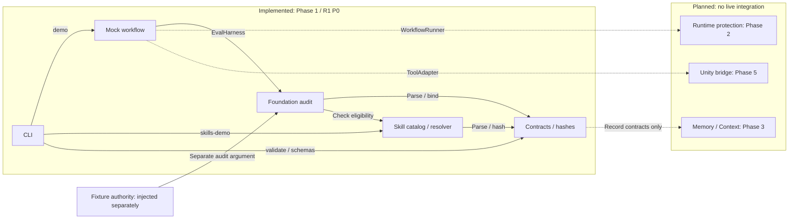

# Foundation architecture and trust limits

This repository implements Phase 1 of roadmap R2 (old P0): T17, T06 and T23. It uses a TypeScript modular monolith with local files, a CLI and deterministic test fixtures. The production workflow engine and Unity adapter are not implemented yet.

| Module | Interface and responsibility | Failure behavior |
|---|---|---|
| Contracts | Parse a named versioned contract; canonicalize/hash JSON | Reject unsupported versions, malformed or extra fields and invalid conditional states |
| Foundation audit | Audit a linked record bundle against separate fixture authorities | Return all detected binding/trust/scope defects; never issue runtime dispatch authorization |
| Skills | Load a pinned catalog, discover metadata, resolve compatibility, read selected resources | Unknown prerequisites remain unknown; missing/mismatched/revoked resources are unavailable |
| Mock workflow | Exercise ModelAdapter, read-only ToolAdapter and EvalHarness through WorkflowRunner | Stop on an adapter error or failed conformance; no executable tool names or arbitrary command strings |
| CLI | Parse inputs, invoke the interfaces, render JSON and a nonzero exit status on failure | Invalid syntax/input is an error, not an empty successful run |

Contracts version `0.5.0` makes the v0.4 document design executable and adds the reviewed execution-skill records. This is an artifact/schema version, not a claim that the whole v0.5 system has been implemented. JSON Schema exports describe structure; executable Zod refinements and cross-record checks remain required for full conformance.

## Module interfaces

Solid arrows show existing local calls or fixture inputs. Dotted arrows show planned integration points; they do not represent running services or implemented adapters. All five implemented modules belong to the same local application.

`ModelAdapter` and `ToolAdapter` currently return fixed fixture data; `EvalHarness` calls the static audit. A future `WorkflowRunner` implementation must add persistence, protected authority stores and dispatch-time checks. Memory/Context has record contracts but no live port implementation yet. Neither fixture authority nor catalog eligibility authorizes production dispatch.

## Actor and store ownership

| Actor | Writable store in the planned runtime | Phase 1 status |
|---|---|---|
| Executor | Candidate workspace, within task scope | Permission model and negative tests only |
| Policy owner | Policy and acceptance oracle/checkset | Separate fixture authority data |
| Verification runner | Trusted evidence | Synthetic records only |
| Gate Controller | Trusted verdicts | Synthetic records only; no production gate issuer |
| Memory promoter | Approved memory | Claim promotion binding checks only |
| Planner / critic | Candidate planning/review artifacts through their future interfaces | Mock model/review fixtures |

The authority configuration is passed separately from candidate records. A candidate cannot gain trust by inserting an actor name, a report or a hash into its bundle. The foundation checker compares these to the configured fixture authorities, including project scope. In Phase 2, those authorities must come from stores protected by real process/principal/filesystem isolation. TypeScript types and an in-memory permission table do not enforce OS isolation.

## Storage and future integration

Source-controlled files contain schemas, fixture definitions and example catalog resources. Generated build output is disposable. Demo output is explicitly fixture data, not a production policy or trusted evidence store. No workspace file is modified by a skill resource, and no package script from a researched repository is executed.

Phase 2 will implement persistent checkpoint/operation stores and dispatch authorization, with one owner process plus an OS lock/queue for Unity resources. Timeout and cancellation must reconcile side effects; TTL expiry must not silently transfer ownership. The framework choice remains a spike at T07; the Phase 1 mock is not a new general workflow framework. LangGraph and Promptfoo are still candidates, not installed runtime dependencies.

Phase 3 adds Memory/Context retrieval, source lifecycle, compaction rehydration and selective invalidation. Phase 4 adds multi-planning, independent critics and measured policy/skill release decisions. Phase 5 validates one Unity bridge plus recipes, trusted reports and the full T22 scope. Only Phase 6 implements the puzzle game.

## Versioning and paths

Reject unknown schema versions rather than coercing them. Hashes use `sha256:` plus 64 lowercase hex characters. Self-hash fields are omitted only at the documented record root when hashing; nested fields remain covered. A reference ID alone never establishes content identity.

Repository scopes use normalized relative POSIX roots (`src`, `Assets/Scenes`), with segment-aware containment. Wildcards, traversal, empty components and platform-absolute paths are unsupported. File resource access also checks the real filesystem; an allowed-looking string is not a filesystem sandbox.

Project profiles distinguish a desired target from an observed environment. Compatibility or eligibility means a candidate can be considered for that profile. It does not certify the skill, assert Unity is installed, or grant permission to execute it. Certification, scope and policy must still be checked at dispatch in the later runtime.
